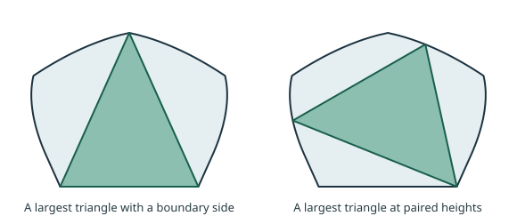

# Solution to Erdős–Purdy–Straus Problem 3.4 on the sharp area ratio for a largest inscribed triangle with a boundary side.

A largest triangle in a convex body shares one side with the boundary. How much larger can the body be than the triangle? The exact maximum is

$$
\boxed{\pi-4\arctan t-t^2=2.3075689464\ldots},\qquad (1+t)^4=2(1+t^2),\quad 0\lt t<\tfrac14.
$$

This answers Problem 3.4 of Erdős, Purdy and Straus (1982). A convex body bounded by elliptic arcs and line segments attains the maximum. The maximizing triangle shown on the left has exactly one boundary side. [Original paper, p. 52](https://users.renyi.hu/~p_erdos/1982-09.pdf#page=8)



The manuscript gives the complete argument and its historical context. [Manuscript (PDF)](manuscript.pdf) · [LaTeX source](manuscript.tex)

## The upper bound

An affine change of coordinates preserves area ratios. Give the common side length one, put it at height zero, and send the third vertex to height one. The triangle has area $1/2$. Write $f(y)$ for the horizontal width of the body at height $y$. Every point lies between heights zero and one. The common side spans the entire section at height zero, since extending it would enlarge the triangle.

For $0\le y\le z\le1$, form a triangle with one base endpoint and opposite section endpoints at $y$ and $z$. Reverse all three choices and subtract the signed doubled areas. The section centers cancel. Each triangle has doubled area at most one in absolute value, so

$$
z-y+zf(y)+yf(z)\le2. \tag{1}
$$

Taking $z=1$ gives $f(y)\le1+y$. To attain the optimum, set $R=1+t^2$, $m=\sqrt{R/2}$, and $s(y)=\sqrt{R-y^2}$. Center the horizontal sections and give them widths

```math
w(y)=\begin{cases}1+y,&0\le y\le t,\\[2pt]2s(y)/R-|1-y/m|,&t\le y\le1.\end{cases}
```

The two pieces have the same value and slope at $t$. The profile is concave, $w(0)=1$, and $w(1)=0$. For $y\in[t,1]$ the height $z=s(y)$ belongs to the same interval. The profile $w$ makes (1) an equality at every such pair in increasing order. Write $D=f-w$. Subtracting the equality from the inequality gives

$$
D(y)\le -\frac{y}{s(y)}D(s(y)).
$$

The substitution $z=s(y)$ reverses $[t,1]$ and has derivative $-y/s(y)$. Integrating the last inequality therefore gives $\int_t^1D\le-\int_t^1D$. Below $t$, the bound $f(y)\le1+y=w(y)$ already applies. Hence every admissible body has area at most $`\int_0^1 w(y)\,dy`$.

## Why the bound is attained

At three heights $0\le x\le y\le z\le1$, the largest possible absolute doubled triangle area in the centered body is

$$
\tfrac12\big[(z-y)w(x)+(z-x)w(y)+(y-x)w(z)\big].
$$

It suffices to check this at $x=0$. Indeed, $w(x)\le1+x$, and concavity gives $w(y)+w(z)\ge1-y\ge z-y$. At $x=0$ we need exactly (1) with $w$ in place of $f$.

When $t\le y\le z$, Cauchy–Schwarz gives $zs(y)+ys(z)\le R$, and the triangle inequality gives $z|1-y/m|+y|1-z/m|\ge z-y$. Adding the bounds proves (1). Both become equalities at conjugate heights $z=s(y)$ with $y\le m\le z$. If $y<t\le z$, the left side of (1) is $2z+y(z-1+w(z))$, which increases with $y$ and is bounded by its value at $t$. When $z<t$, it is at most $2t(1+t)<2$. Thus no triangle beats the displayed one.

Finally, $`\int_t^1 2s(y)/R\,dy=\pi/2-2\arctan t`$ and $`\int_t^1|1-y/m|\,dy=2m-1-t`$. Adding the linear piece and doubling gives the claimed ratio.

## Source, earlier claim and verification

Straus’s Lemma 2 (1978) claims $\sqrt5$ for all convex bodies under this boundary-side condition. Fleischer, Mehlhorn, Rote, Welzl and Yap (1992) identified the sharp $\sqrt5$ bound for pentagons. Their hexagon has ratio $9/4>\sqrt5$ and a largest triangle with exactly one boundary side. Their Theorem A.6 proves that $9/4$ is sharp among all polygons with at most six vertices. This earlier example already contradicts the general bound. The result here determines the exact maximum for arbitrary convex bodies and constructs an attaining body. [Straus, Lemma 2, p. 309](https://doi.org/10.1007/BFb0062546) · [Fleischer et al., Lemma A.4, its remark and Theorem A.6](https://people.mpi-inf.mpg.de/~mehlhorn/ftp/SimultaneousApproximation.pdf#page=21)

Jerónimo-Castro and Roldán-Pensado restated Straus’s general assertion as Lemma S. Their proof of Theorem 3 uses it only to bound the area of the pentagon in Figure 9 relative to its largest triangle. The valid pentagon inequality supplies this step, so their conclusion $\lambda(K,4)\le(1+\sqrt5)/2$ holds. Edgardo Roldán-Pensado reviewed the argument presented here and believes the sharp bound is correct. He also confirmed that Lemma S fails as stated and that the pentagon bound suffices for Theorem 3. [Jerónimo-Castro and Roldán-Pensado, pp. 337–338](https://doi.org/10.1007/s00454-010-9293-9)

The Lean statement uses compact convex subsets of the real plane, ordinary area, and all competing triangles. It also proves that allowing interior vertices gives the same bound: along each vertical section, the absolute determinant is largest at a boundary endpoint. The proof constructs an extremizer, proves the bound for arbitrary bodies, and checks the integral and the comparison with $\sqrt5$. OpenAI Codex developed the proof and formalization. [Statement](Statement.lean) · [Boundary equivalence](Boundary.lean) · [Area bound](Dual.lean) · [Extremizing body](Extremizer.lean) · [Final proof](Solution.lean)

```sh
# Run at the merge commit for PR #81.
python3 scripts/verify.py --base HEAD^ --fetch-cache
```
