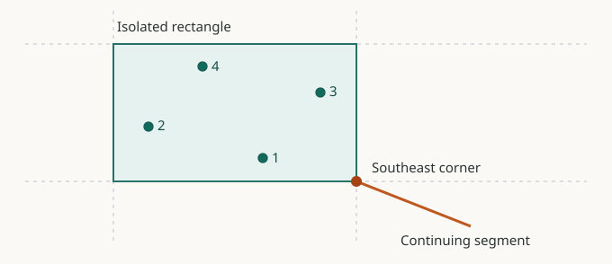

# Disproof of Presutti and Stromquist’s Conjecture 10.1 on the proposed packing-density optimizer for 2413

Four entries form 2413 when their ranks from left to right are $2,4,1,3$. A weighted permutation of 544 points gives the lower bound

```math
\delta(2413)\;\ge\;\frac{118609967629}{1132462080000}
=0.104736370182920385\ldots
```

This exceeds the estimate $0.10473602526603545\ldots$ in Presutti and Stromquist’s Conjecture 10.1. A separate argument disproves the proposed optimizer for every choice of its two bubble sizes. [Original chapter, pp. 315–316](https://doi.org/10.1017/CBO9780511902499.015)

The obstruction is a corner of the last bubble. Points inside the bubble can form a copy of 2413 together. At its southeast corner, that opportunity disappears. An optimal arrangement must give the same chance of participating in a copy at almost every sampled point.



## The finite construction

Place 32 points on each of four subsegments of a descending line and put a four-point copy of 2413 into each of two gaps. Take all four quarter-turns of this configuration. The result has $(4\cdot32+2\cdot4)\cdot4=544$ points with distinct horizontal and vertical coordinates. Each point has a positive integer weight. Their sum is $`W=30\,720`$. [Coordinates and weights](RationalWitness.lean)

Fix the first and last points of a potential copy in horizontal order. The first must lie below the last. Scan the points between them from left to right. Each time a point lies below the first endpoint, multiply its weight by the total weight of earlier points above the last endpoint. The product counts the possible middle pair. Multiplication by the endpoint weights and summation gives $`S=3\,886\,611\,419\,267\,072`$. Four independent samples therefore form 2413 with probability $24S/W^4$. Replacing each point by a small increasing segment of the same mass preserves all these copies. A separate proof certifies the lower bound with enclosing rectangles. It discards boxes that cannot contain the pattern and splits the wider interval in the first comparison that remains undecided. If all six inequalities hold throughout the boxes, it adds the product of the four box weights. [Counting proof](RangeCount.lean) · [Probability theorem](Quantitative.lean)

## Why the corner matters

Model the arrangement by a probability measure $\mu$ on the unit square. Let $D$ be the probability that four independent samples form 2413. For a fixed point $p$, let $H(p)$ be the probability that $p$ and three fresh samples form 2413. Replacing a fraction $\epsilon$ of the measure by mass at $p$ changes the packing rate to

$$
D+4\epsilon\bigl(H(p)-D\bigr)+O(\epsilon^2).
$$

At a maximum, $H(p)\le D$ for every $p$. Also $`\int H\,d\mu=D`$, so $H(p)=D$ for almost every sampled point. At a point $c$ whose horizontal and vertical lines have zero mass, $H$ is continuous. Moving $c$ slightly preserves all comparisons with almost every triple of other samples. If every neighborhood of $c$ has positive mass, then $H(c)=D$ as well.

Now suppose a rectangle $R$ contains a copy of the entire arrangement. Suppose also that almost every point outside $R$ lies outside both its horizontal and its vertical coordinate intervals. Let $c$ be its southeast corner and $q$ a point inside. Compare the pattern made with three other samples.

- With all three outside, $c$ and $q$ have the same order relative to every sample.
- With one or two inside, the points in the rectangle, including the distinguished point, occupy consecutive positions and consecutive ranks. The pattern 2413 has no block of two or three such entries.
- With all three inside, $c$ has the greatest horizontal coordinate and the least vertical coordinate. The last entry of 2413 has rank three, so $c$ cannot complete the pattern. An interior point sometimes can.

If $R$ contains 2413 with positive probability, these cases give $H(q)\ge H(c)$ throughout $R$ and strict inequality on a set of positive mass. Thus $H(c)=D$ is impossible at a maximum.

## The published construction

On the bottom segment, use the parameterization $b(t)=(1/4+t/2,(1-t)/4)$. The second bubble occupies the rectangle spanned by $b(t_1)$ and $b(t_2)$, where $0<t_1<t_2<1/2$. It has mass $(t_2-t_1)/2$ and contains a rescaled copy of $\mu$. The parenthesis on printed page 315 squares the box masses. The CDF in equation (34) gives the linear masses, whose fourth powers appear in the packing formula on page 316. Its southeast corner is exactly $b(t_2)$. From there the central segment continues with strictly positive density. Thus every neighborhood of the corner has positive mass. The other segments and recursive bubbles lie outside both coordinate intervals, and the boundary lines have zero mass.

Any maximizing measure has positive packing rate, since even four atoms arranged as 2413 have positive rate. Its copy inside the second bubble would therefore satisfy every hypothesis of the corner obstruction. This rules out the whole two-bubble family and leaves the value of the packing density open.

## Source and verification

Cathleen Battiste Presutti and Walter Stromquist published the conjecture in *Permutation Patterns* (2010). The chapter abstract gives approximately $0.10472423$ and the body gives approximately $0.10473603$ for the proposed rate. The argument tests the specified measure for every admissible parameter choice. Section 11 discusses an infinite sequence of bubbles as an alternative. Searches of the chapter’s citations and subsequent work on four-point packing found upper bounds and no earlier disproof of the proposed optimizer. OpenAI Codex developed and formalized this proof. [Cambridge chapter](https://doi.org/10.1017/CBO9780511902499.015) · [Full volume, pp. 287 and 315–316](https://ndl.ethernet.edu.et/server/api/core/bitstreams/a49fe666-c981-440f-b0d3-0b73b40574c6/content)

The proof uses the Borel probability experiment directly. [Statement and recursive construction](Statement.lean) · [First variation](Density.lean) · [Constancy on the support](Variation.lean) · [Corner obstruction](Block.lean) · [Final theorem](Solution.lean)

~~~sh
# Run at the merge commit for PR #84.
python3 scripts/verify.py --base HEAD^ --fetch-cache
~~~
