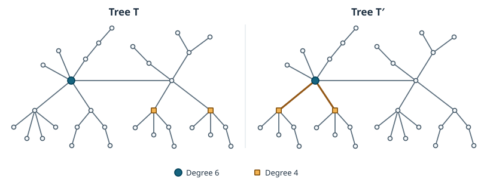

# Two 32-vertex trees have the same five-cut polynomial

Aliste-Prieto, de Mier, and Zamora predicted that the smallest such pair has 34 vertices. The two trees below have 32. For each way to delete up to five edges, record the sizes of the resulting components in any order. Every list of sizes occurs equally often in both trees. The form of the trees also gives a quadratic upper bound at every cut depth.



The trees are nonisomorphic. In the right tree, the degree-six vertex has two neighbors of degree four. In the left tree it has none. The two trees separate at six cuts. For example, the component orders $(16,4,3,3,2,2,2)$ occur three times on the left and once on the right.

## The conjecture

Write $U_m(T)$ for the polynomial in which each set of at most $m$ deleted edges contributes one monomial $\prod_C x_{|C|}$. Here $C$ runs over the components left by those deletions. Let $\Phi(m)$ be the least common order of two nonisomorphic finite unrooted trees with equal $U_m$. Conjecture 15 asserts, for $m\ge2$,

$$
\Phi(m)=
\begin{cases}
6\cdot 2^{m/2}-2,&m\ \text{even},\\
18\cdot 2^{\lfloor m/2\rfloor-1}-2,&m\ \text{odd}.
\end{cases}
$$

The predicted minima are known for $m=2,3,4$. The pair in the figure gives $\Phi(5)\le32<34$. Its exact minimum remains open. For the full chromatic symmetric function, Stanley asked whether any two nonisomorphic trees can agree at *every* cut depth. That question remains open as well. [Aliste-Prieto, de Mier and Zamora, *Discrete Mathematics* 344 (2021), 112255, Conjecture 15 and Proposition 16](https://doi.org/10.1016/j.disc.2020.112255) · [Accepted manuscript, section 4](https://upcommons.upc.edu/server/api/core/bitstreams/d37478c0-b2df-4e6e-a862-358d205545a4/content) · [Smith, Smith and Tian, small cases](https://arxiv.org/abs/1505.01889)

## Why five cuts agree

In a rooted tree, keep the size of the component containing the root separate from all other component sizes. Let $t$ count deleted edges. Two rooted polynomials whose difference is divisible by $t^h$ agree through $h-1$ cuts.

Let $X,Y$ be the path on three vertices, rooted at its middle or at an end. Their rooted polynomials $x,y$ agree at zero cuts. Forgetting the root gives the same unrooted polynomial. Write $uv$ for identifying the roots of two trees and $H(u)$ for attaching a new root by one edge. On rooted polynomials,

$$
H(u)=zu+tL(u).
$$

Here $z$ adds a vertex to the root component, and $L$ records the size of that component as an ordinary part. The variable $z$ records the root component order minus one. Thus root identification multiplies polynomials, and $L$ is linear over the ring of cut counts and ordinary components.

The construction uses four rooted trees with polynomials $a,b,c,d$.

| Pieces | Construction | First possible difference |
|---|---|---|
| $a,b$, six vertices each | Join $X$ and $Y$ by an edge; choose either endpoint of that edge as the root. | $t^2$ |
| $c,d$, eleven vertices each | $c=H(x^2)H(y^2)$ and $d=H(xy)^2$. | $t^3$ |

For the first row, keeping the joining edge gives the same contribution. Cutting it gives the common unrooted polynomial times $t(x-y)$. For the second row, write $x=y+\delta$. Linearity gives

$$
H(x^2)H(y^2)-H(xy)^2
=H(\delta^2)H(y^2)-H(\delta y)^2.
$$

Two factors of $\delta$ supply $t^2$. The terms with no further cut cancel because $(z\delta^2)(zy^2)=(z\delta y)^2$. This supplies one more factor of $t$.

Finally, connect $ac$ to $bd$ by one edge in the first tree, and $ad$ to $bc$ in the second. Keeping this edge gives the same product. When it is cut, the difference is

$$
t\,[L(ac)L(bd)-L(ad)L(bc)].
$$

The determinant is linear in each of $a-b$ and $c-d$. The total difference is divisible by $t^{1+2+3}=t^6$, as required.

## A quadratic upper bound

Start with $x,y$ above. Replace any pair of rooted polynomials $u,v$ by

$$
H(u^2)H(v^2),\qquad H(uv)^2.
$$

If $t^h$ divides $u-v$, the same determinant calculation gives a factor $t^{2h+1}$ after one step. If the inputs have order $n$, the outputs have order $4n-1$. After $k$ steps the trees have order $(8\cdot4^k+1)/3$ and agree through $2^{k+1}-2$ cuts.

To see why the new trees are nonisomorphic, remove their common top root. The two components each have $(n_{\rm new}-1)/2$ vertices, so this root is the unique centroid and any isomorphism must fix it. In the first tree the two child branches have rooted types $u^2$ and $v^2$. In the second they both have rooted type $uv$. A rooted tree is determined by the multiset of its child branches. Cancellation in that multiset gives $u^2=uv$ only when $u=v$. The two starting rootings of the path are different, so induction separates every pair from the first step onward.

For $m\ge1$, take $k=\lfloor\log_2(m+1)\rfloor$. Then $k\ge1$, $2^k\le m+1<2^{k+1}$, and the construction gives

$$
\boxed{\Phi(m)\le 3(m+1)^2.}
$$

This bound replaces the conjectured exponential growth with a quadratic upper bound. Whether $\Phi(m)$ tends to infinity remains open. [Relation to Stanley's question, Proposition 16](https://arxiv.org/pdf/2002.08186#page=11)

## Verification and provenance

From this branch, run the following commands with Elan. The project pins Lean 4.36.0 and Mathlib 4.36.0, commit `fc4f59e577feb1a4956671bc04ac18aaaf8cd842`.

```sh
lake build
lake env leanchecker conjectures.RestrictedUMinimum.Solution
lake env leanchecker conjectures.RestrictedUMinimum.Growth
```

The statement quantifies over finite tree presentations. Any finite tree admits one by choosing a root and assembling its child subtrees. Isomorphism uses the underlying unrooted simple graph. The cut expansion sums over actual edge choices and records the component sizes. The formal proof of the quadratic bound distinguishes the two unrooted graphs by an independent integer-valued two-spin sum.

OpenAI Codex agents developed the construction and the formal proofs. The rooted polynomial product rules and the original extremal family are due to Aliste-Prieto, de Mier, and Zamora. A separate check rebuilt the two pictured trees and enumerated all 206,368 deletions of zero through five edges in each. The 372 nonzero partition counts agree. A search of the original paper's forward citations and of the literature for five-cut examples and polynomial upper bounds found no earlier refutation.

The initial counting approach used the authors' 2017 connection to equal sums of powers. It produced much larger candidate trees. Tracking how the first unequal cut term changes under root identification led to the smaller witness and the quadratic bound. Neither the 32-vertex construction nor the quadratic estimate asserts an optimal size. [Aliste-Prieto, de Mier and Zamora (2017)](https://arxiv.org/abs/1509.09210)
