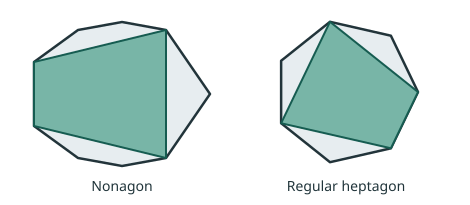

# Disproof of the quadrilateral case of Straus’s Conjecture 1 on largest inscribed polygons with a boundary side

The largest quadrilateral in the convex nonagon below occupies exactly two-thirds of its area. In a regular heptagon, an inscribed quadrilateral occupies more than two-thirds. This disproves Conjecture 1 of E. G. Straus (1978), already for four vertices. [Original paper, p. 309](https://page-one.springer.com/pdf/preview/10.1007/BFb0062546#page=2)



Straus considered a largest-area inscribed $n$-gon that shares a side with its surrounding convex body. He proposed that, for $n\ge 3$, its fraction of the body's area is smallest when the body is a regular $(2n-1)$-gon. The same example refutes the one-shared-side case of his Conjecture 2.

## The nonagon

At horizontal coordinates $0,1,2,3,4$, take points at the following vertical coordinates.

| Horizontal coordinate | 0 | 1 | 2 | 3 | 4 |
| --- | --- | --- | --- | --- | --- |
| Vertical coordinates | $\pm4$ | $\pm8$ | $\pm9$ | $\pm8$ | $0$ |

The drawing scales the two coordinate axes separately. Their convex hull has area $12+17+17+8=54$, by its four vertical strips. The trapezoid with vertices $(0,\pm4)$ and $(3,\pm8)$ has area $36$. Its vertical side at $x=0$ lies on the boundary. Each of its other three sides has a midpoint in the interior.

Twice a quadrilateral's area is the absolute determinant of its two diagonals. The signed determinant is affine in each vertex separately, so its absolute value attains a maximum at four vertices of the nonagon. For a chord with horizontal displacement of magnitude $j$, the vertical displacement has magnitude at most $D_j$, where

$$
(D_0,D_1,D_2,D_3,D_4)=(18,17,16,12,4).
$$

Two diagonals with horizontal displacements of magnitudes $i,j$ therefore have absolute determinant at most $iD_j+jD_i$. The five entries give $iD_j+jD_i\le72$ in every case. This proves the trapezoid is maximal.

## The regular heptagon

Write $\theta=2\pi/7$. Take the vertices numbered $0,2,4,6$ in counterclockwise order on the unit circle. Their successive angular gaps are $2\theta,2\theta,2\theta,\theta$. The quadrilateral and the heptagon have respective areas $(3\sin(2\theta)+\sin\theta)/2$ and $7\sin\theta/2$. Their ratio is

$$
\frac{1+6\cos(2\pi/7)}7 > \frac23 .
$$

Indeed, $c=\cos(2\pi/7)>1/2$ solves $8c^3+4c^2-4c-1=0$. The polynomial is increasing beyond $1/2$ and is negative at $11/18$. Thus $c>11/18$, as required.

## Source and verification

Straus’s Conjecture 1 includes triangles. The 1992 hexagon of Fleischer, Mehlhorn, Rote, Welzl and Yap has body-to-triangle area ratio $9/4$, exceeding the regular pentagon’s $\sqrt5$. One of its largest triangles shares exactly one boundary side. Thus their example already refutes Conjecture 1 and the one-side case of Conjecture 2 at $n=3$. The nonagon here refutes the prediction at $n=4$. We located no earlier example for that case. Erdős, Purdy and Straus later asked for sharp ratios with prescribed boundary sides in Problem 3.5. [Straus, p. 309](https://doi.org/10.1007/BFb0062546) · [Fleischer et al., Lemma A.4 and Figure 13](https://people.mpi-inf.mpg.de/~mehlhorn/ftp/SimultaneousApproximation.pdf#page=21) · [Erdős–Purdy–Straus, p. 52](https://users.renyi.hu/~p_erdos/1982-09.pdf#page=8)

Lean represents compact convex bodies with interior and inscribed polygons in boundary order. It checks maximality of the trapezoid, the nonagon area, the number of shared sides and the strict area comparison. The theorem `quadrilateral_counterexample` refutes the prediction at $n=4$. Its corollary `conjecture1_false` refutes the published conjecture. For the heptagon comparison, it certifies rational enclosures using the displayed cubic and integrates three enclosing trapezoids. [Statement](Statement.lean) · [Proof](Solution.lean)

```sh
# Run at the merge commit for PR #75.
python3 scripts/verify.py --base HEAD^ --fetch-cache
```

OpenAI Codex found the four-vertex counterexample by optimizing symmetric polygonal sections and produced the proof and Lean formalization.
